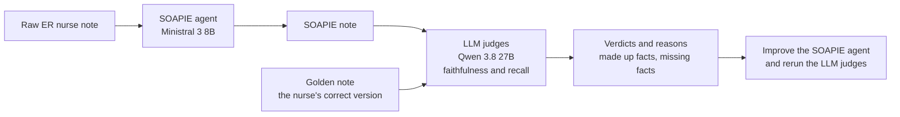

# ER Nurse Notes Eval

A working reference for building evaluation and correction loops for LLM applications with DeepEval. It uses one high stakes example, an AI agent that turns ER nursing shorthand into structured chart notes, to show how LLM judges catch what a model makes up (hallucinations) or leaves out (omissions), how to prove those LLM judges are right before trusting them, and how their verdicts drive the next fix. This is the evaluation and correction loop in practice. It is written for stakeholders who want to see how AI output gets verified, and for engineers building their own evaluation harness.

## What DeepEval is

DeepEval is an open source framework for testing LLM applications, much like pytest is for regular code. Its scoring unit is the metric. A metric grades one quality of an output, such as faithfulness, and returns a score from 0 to 1 with a written reason for that score.

The score works in one of two ways. By default it is graded, so a faithfulness score of 0.94 means 94% of the claims in the output checked out, and a threshold you set decides whether that passes. In strict mode it is all or nothing: the score is 1 or 0, and anything short of perfect fails.

DeepEval includes more than 50 metrics. Most of them are LLM judges, and a few use plain code, such as an exact text match. An LLM judge is a second language model given strict instructions to grade another model's output. DeepEval ships built in LLM judges such as FaithfulnessMetric, and its GEval metric lets you build your own from grading steps written in plain language.

## The evaluation and correction loop

An evaluation tells you what is wrong. A correction loop uses that to make the system better. The application produces an output, the LLM judges score it and explain every failure, the failures point to the fix, and the same LLM judges run again so every fix is measured, not guessed.



One step comes before the loop: proving the LLM judges. An LLM judge is a language model too, so it can be confidently wrong. Each LLM judge in this repo is tested on cases where a domain expert has already set the right verdict, called the answer key, before it grades anything.

## The example

AI tools that turn a clinician's quick notes into a finished chart are spreading fast. A language model writes fluently even when it is wrong. It can add a medication that was never given or leave out an allergy, and the note still reads perfectly. In a medical record, either mistake can hurt a patient.

The SOAPIE agent takes a nurse's raw shorthand note from the emergency department and rewrites it as a SOAPIE note, a standard nursing format with six sections: Subjective, Objective, Assessment, Plan, Intervention and Evaluation. This is the raw note used throughout the repo. It is synthetic and describes a patient having a heart attack.

```
1432 58yo M amb to triage c/o CP x2h, 7/10 pressure, rad to L arm, +diaphoretic, +nausea. A&Ox4, skin pale/clammy. NKDA. Hx HTN, HLD. Took ASA 81 at home.
VS: BP 164/96, HR 108, RR 22, SpO2 94% RA, T 98.4, pain 7/10.
1436 EKG done, ST elev II III aVF. Dr notified, at bedside. STEMI alert called.
18g R AC, 20g L FA, labs drawn (trop, BMP, CBC, coags). 2L NC, SpO2 now 98%. Cont monitor, NSR w/ occ PVCs.
ASA 324 chewed, NTG 0.4 SL x1, pain down to 4/10, BP 148/88. Pt denies SOB, no new c/o.
1450 cath lab accepted, transport at bedside. Wife present, updated. Report given to cath RN.
```

Two LLM judges (faithfulness and recall) then grade the SOAPIE agent's note that was created from the nurse's shorthand note.

The **faithfulness LLM judge** catches hallucinations, meaning anything the SOAPIE agent made up. It is DeepEval's built in FaithfulnessMetric. It breaks the SOAPIE agent's note into individual claims and checks each one against the raw note. Any medication, dose or event the nurse never charted fails the note.

The **recall LLM judge** catches omissions, meaning anything the SOAPIE agent left out. It is built with GEval from grading steps written by a nurse. It compares the SOAPIE agent's note against a golden note, the correct SOAPIE note written and reviewed by a nurse. In evaluation work this reference is often called a golden answer. Any fact from the golden note that is missing fails the note.

Both LLM judges run in strict mode. One invented or missing fact fails the whole note, because in a chart one wrong fact is enough to matter.

## Proving the LLM judges first

Before the LLM judges grade the SOAPIE agent, they are tested on four SOAPIE notes written by hand. Each one is the nurse's golden note, either unchanged or with one deliberate change, so the right verdict from each LLM judge is known in advance. Those expected verdicts are the answer key. The four notes and the answer key are in [data/cases.json](data/cases.json).

| Case | What was changed | Faithfulness LLM judge should | Recall LLM judge should |
|---|---|---|---|
| Good | Nothing. This is the nurse's golden note | Pass | Pass |
| Invented fact | "Morphine 4 mg IV given" added. No morphine was charted | Fail | Pass |
| Reworded | Same facts in different words, such as "high blood pressure" for "hypertension" | Pass | Pass |
| Dropped fact | "No known drug allergies" (NKDA in the raw note) removed | Pass | Fail |

Four cases and two LLM judges make eight verdicts. The faithfulness LLM judge should fail only the invented fact, and the recall LLM judge should fail only the dropped fact. The reworded note checks that neither LLM judge punishes different wording. Both LLM judges get all eight verdicts right, and the pytest suite in [tests/test_judges.py](tests/test_judges.py) reruns all eight with one command.

## Why a nurse built the LLM judges

On the first test, the faithfulness LLM judge failed the nurse's own golden note, with a confident explanation that the note got the timing wrong. The LLM judge was the one that was wrong. ER nurses chart in timed blocks: a time like 1436 opens a block of care, and everything written under it happened at or after that time and before the next timestamp. The LLM judge did not know that convention.

Lowering the passing score would have hidden the problem and let the invented morphine through, the same one shown in the Invented fact case above. Instead, the charting convention was added to the LLM judge's instructions through DeepEval's evaluation_template override, with strict mode unchanged. After that, the golden note passed and the morphine still failed. An LLM judge is only as good as the person who decides what correct means. This is why domain expertise is invaluable.

## The first SOAPIE agent run

The SOAPIE agent runs on Ministral 3 8B, a small open weight model from Mistral. The LLM judges run on Qwen 3.8 27B, a larger model from a different family, so an LLM judge never grades writing from its own model family.

On its first run, the SOAPIE agent misread "2L NC," which means 2 liters of oxygen through a nasal cannula, as 2 liters of IV normal saline. It then charted the oxygen level as improving "on room air," and added events no one charted, such as the patient tolerating transport before transport had happened. The faithfulness LLM judge flagged the saline as a contradiction of the raw note, and the recall LLM judge flagged the missing oxygen. Both verdicts matched a registered nurse's review of the same note. The SOAPIE agent's full note is saved in [outputs/agent_run_1.md](outputs/agent_run_1.md).

Next, the SOAPIE agent's instructions are revised to fix these errors: one note instead of one per timestamp, abbreviations like NC read correctly, and no events that were never charted. The same LLM judges then grade the new note, which closes the evaluation and correction loop.

## Run it

The models run locally through Ollama, so no note is sent to a hosted model. The stack is Python 3.13 managed with uv, pytest and DeepEval.

```
uv sync
ollama pull ministral-3:8b
ollama pull qwen3.8:27b
uv run pytest tests/test_judges.py -v
uv run python -m scripts.run_agent_and_judge
```

DeepEval sends anonymous usage telemetry by default. Set the environment variable DEEPEVAL_TELEMETRY_OPT_OUT=1 to turn it off.

To use an API model, change the model that make_judge (judges/model.py) returns. DeepEval supports hosted models such as Claude and GPT. The SOAPIE agent's model call is in write_soapie (agent/soapie_agent.py). Hosted models should only receive synthetic data, or real patient data under a business associate agreement (BAA) with the provider.

## Status

Under active development. Both LLM judges are built and match the nurse's answer key on all eight verdicts. The SOAPIE agent is built and its first run has been graded. SOAPIE agent improvements are next, followed by Allure reports and a small dashboard that shows each score next to the LLM judge's reasoning.

## Data

All notes are synthetic. No real patient information is used anywhere in this repo.

## About

Built by Richard Hall, a former ER nurse and nurse manager who now works as an AI engineer. Every golden note and expected verdict is written or reviewed by a nurse.